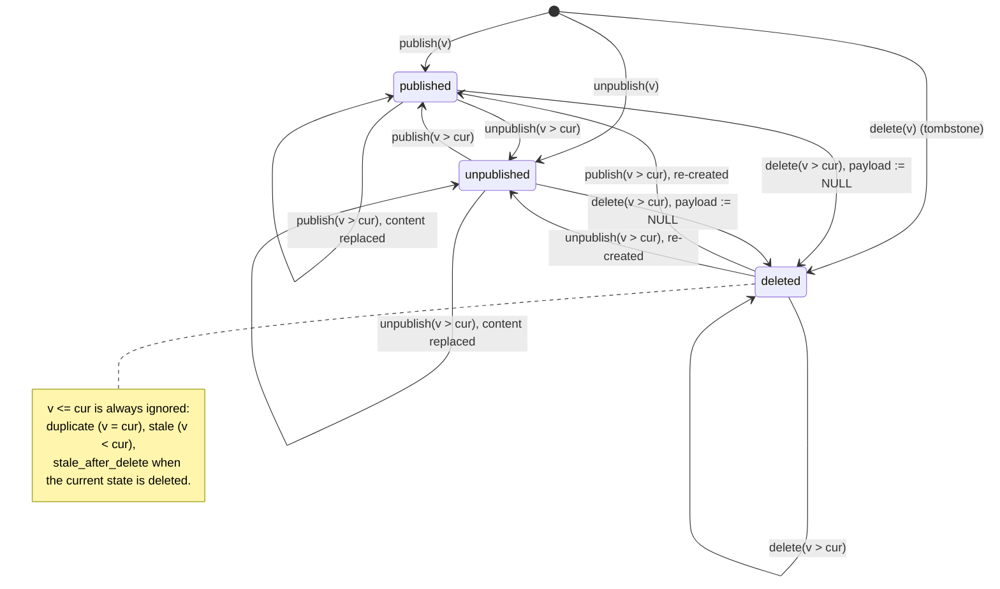

# Architecture

This document explains how the CMS Content Sync Service works and why it is built this way. The
full reasoning behind every decision, including the alternatives that were rejected, is in
[`specs/001-cms-content-sync/research.md`](../specs/001-cms-content-sync/research.md) (R1–R21).
The API contract is in
[`contracts/openapi.yaml`](../specs/001-cms-content-sync/contracts/openapi.yaml).

## 1. Overview

```text
            HTTP Basic                        Sanctum bearer tokens
  CMS ──────────────────► POST /cms/events      GET/PUT/DELETE /api/v1/...  ◄──── users / admins
                                │                           │
                     validate whole batch                   │ visibility scope + gates/policies
                                │                           │
            ┌───────── one transaction ─────────┐           │
            │ INSERT event_batches (raw body)   │           │
            │ INSERT jobs (ProcessEventBatchJob)│           │
            └───────────────────────────────────┘           │
                                │ 202 {batch_id}            │
                                ▼                           ▼
                     queue worker (database driver)  ──►  contents (replica + tombstones)
                     sorted advisory locks, ordered,
                     atomic, version precedence
```

Everything runs in one Laravel 13 application on PostgreSQL 18. Docker Compose provides nginx,
php-fpm (`app`), `worker`, `scheduler` and `postgres`.

## 2. Data model

| Table | Purpose | Key constraints |
|---|---|---|
| `contents` | Local replica of each CMS entity, addressed by `cms_id`. | Unique `cms_id`; `version > 0`; status ∈ {published, unpublished, deleted}; `payload IS NULL` ⇔ deleted; payload is a JSON object. |
| `event_batches` | Durable inbox of acknowledged deliveries. | Status ∈ {pending, processed, failed}; 1–100 events; `events` is a JSON array. |
| `users` | Consumer accounts with a `role` (user/admin). | No password columns; unique email. |
| `personal_access_tokens` | Sanctum tokens. | Only a SHA-256 hash of each token is stored. |
| `jobs`, `failed_jobs` | Database queue. | Same database as the data, which makes the atomic hand-off possible. |

**Field ownership** is what keeps CMS data and the local override independent:

| Written only by event processing | Written only by the administrator override |
|---|---|
| `cms_id`, `version`, `status`, `payload`, `cms_timestamp`, `synced_at` | `is_disabled`, `disabled_at`, `disabled_by` |

**Indexes.** Each consumer listing is an index scan in feed order, with no sort step. This was
verified with `EXPLAIN` on 100k rows:

- `contents_user_feed_idx (synced_at DESC, cms_id DESC) WHERE status = 'published' AND NOT is_disabled`
- `contents_admin_feed_idx (synced_at DESC, cms_id DESC) WHERE status <> 'deleted'`
- `event_batches_status_received_idx (status, received_at DESC, id DESC)`

### CMS state machine

An event is applied only when the entity is unknown or its `version` is **strictly higher**
than the stored one. Timestamps are never compared.



## 3. Event processing

```mermaid
sequenceDiagram
    autonumber
    participant CMS
    participant API as Webhook (php-fpm)
    participant DB as PostgreSQL
    participant W as Worker
    CMS->>API: POST /cms/events (Basic auth, 1–100 events)
    API->>API: constant-time auth, 415/413 checks, whole-batch validation
    alt any event invalid
        API-->>CMS: 422 problem details (nothing stored)
    else valid
        API->>DB: BEGIN; INSERT event_batches(raw body); INSERT jobs; COMMIT
        API-->>CMS: 202 {batch_id}  (or 503 if the commit failed, so the CMS retries)
    end
    W->>DB: reserve job
    W->>DB: BEGIN; SELECT batch FOR UPDATE (skip if processed)
    W->>DB: pg_advisory_xact_lock(hash(cms_id)) for each id, sorted
    loop each event, in received order
        W->>DB: read snapshot (version, status)
        W->>W: EventPrecedence::decide (pure)
        W->>DB: upsert CMS-owned columns WHERE version < incoming<br/>(payload copied from the inbox in SQL)
    end
    W->>DB: mark batch processed; COMMIT
    W->>W: log applied/ignored/processed (only after commit)
```

The main design points:

- **Precedence is a pure function.** `app/Domain/Cms/EventPrecedence.php` has no framework
  dependencies, so it is unit-tested exhaustively. That includes a property test that checks
  200 random permutations and duplications of event sets (SC-001).
- **Atomic, ordered batches.** A batch is applied in a single transaction, in the order
  received. Any failure rolls back every change and the batch status.
- **Concurrency.** Transaction-scoped advisory locks are taken on the content ids, in sorted
  order. They lock ids that do not exist yet, which `SELECT … FOR UPDATE` cannot do, and the
  fixed ordering prevents deadlocks. A test runs real parallel processes; with the locks
  unsorted it fails with `40P01 deadlock detected`. The `version < incoming` guard on the upsert
  is defence in depth.
- **Payload fidelity.** The inbox stores the validated raw body as `jsonb`, and the worker
  copies `events -> i -> 'payload'` with SQL. On the read path, the API embeds the stored `jsonb`
  text in the response without decoding it in PHP (`RawJson`). Payloads never go through PHP
  decoding at all, so `{}` stays `{}` and numbers keep arbitrary precision end to end.
- **Timestamps.** Offsets are validated against the RFC 3339 range (hh 00–23, mm 00–59) and
  normalized to UTC before storage, so every valid offset is storable (PostgreSQL itself only
  accepts offsets up to ±15:59). Fractional seconds are kept (`timestamptz(6)`).
- **Reliability.** Jobs are retried 5 times with backoff (5 s, 30 s, 2 min, 10 min). After that
  the batch is kept as `failed`, and administrators (API) or operators (CLI) can re-process it.
  An acknowledged batch is never silently dropped.

## 4. Security model

| Actor | Credential | Can do |
|---|---|---|
| CMS | HTTP Basic, from environment variables only | `POST /cms/events` and nothing else |
| User | Sanctum bearer token (role `user`) | Read published, enabled content |
| Admin | Sanctum bearer token (role `admin`) | Read all non-deleted content, filter, disable/enable, manage batches |

- The CMS and consumer credentials are completely separate: each route accepts only one kind,
  and anything else gets a `401` with the appropriate `WWW-Authenticate` challenge.
- **Authorization goes through gates and policies only.** The `admin` gate is the single source
  of role decisions. An architecture test fails if `isAdmin()` is called anywhere else.
- Admin routes are authorized before route-model binding, so a regular user gets an identical
  `403` whether or not the id exists. Hidden and unknown content both return the same `404`.
- No endpoint can modify CMS-owned columns. A test asserts the complete list of write routes.
- No endpoint is anonymous, not even the `GET /up` health check: it requires a consumer token,
  and the access matrix test covers it.
- Rate limits are applied per token (API) and per IP (webhook). Request bodies are limited to
  1 MiB.

## 5. Consumer API design

- There is one role-aware resource, `/api/v1/contents`: administrators get two extra fields,
  `status` and `local_override`. The local override is modelled as a sub-resource
  (`PUT`/`DELETE /contents/{id}/disabled`), which makes its local, independent nature explicit.
- **Pagination.** Cursor pagination is the default because it stays stable while the CMS keeps
  updating content. Sending `page` switches to page-number pagination with totals. Tampered
  cursors are rejected with `422`, never a SQL error.
- **Errors** follow RFC 9457 (`application/problem+json`) on every route.

## 6. Observability

The JSON `cms` channel records the whole lifecycle:

- `cms.batch.received`, `cms.batch.rejected` (field paths only), `cms.event.applied`,
  `cms.event.ignored` (with the reason), `cms.batch.processed` (counts and duration),
  `cms.batch.attempt_failed`, `cms.batch.failed`, `cms.batch.retry_requested`,
  `cms.batch.discarded`, `content.override.changed`.

Records are correlated through `X-Request-Id`, which is propagated to the worker through Laravel
`Context`.

Logs must never contain credentials, tokens or payload content:

- `SafeError` and a custom `QueryException` reporter strip SQL bindings, because the inbox
  `INSERT` binds the whole batch body.
- `zend.exception_ignore_args` keeps function arguments out of stack traces.
- A test replays the quickstart scenarios and asserts that no secret, token or payload sentinel
  appears in any log record. A mutation test confirmed it catches a leak.

## 7. Decisions and trade-offs

| Decision | Why | Trade-off accepted |
|---|---|---|
| Asynchronous processing through a transactional inbox ([R2](../specs/001-cms-content-sync/research.md#r2-webhook-processing-model-asynchronous-with-a-transactional-inbox)) | Once a batch is acknowledged, not losing it is our responsibility. Ingestion stays fast, load spikes are absorbed, and adding workers scales processing. | Eventual consistency: content becomes visible about 1 s after acknowledgement. The CMS gets no per-event result. A worker must run. |
| Queue on the same PostgreSQL database (R2) | The inbox row and its job are committed together, so there is no "acknowledged but never queued" window. | Moving to Redis or SQS would require a transactional outbox relay. |
| Sorted advisory locks (R5) | Lock ids that do not exist yet, and avoid deadlocks. | Hash collisions can serialize unrelated ids (only a performance cost). |
| Tombstones instead of hard deletes (R7) | Make "older events cannot restore content" enforceable. | Deleted rows stay in the table, but without a payload. |
| Sanctum opaque tokens (R10) | First-party, revocable, hashed at rest, stateless. | Tokens are issued by an operator through the CLI; there is no self-service flow. |
| Cursor and page pagination (R13) | Stable cursors for synchronizers, totals for user interfaces. | Two modes to document and test. |
| RFC 9457 errors (R15) | One standard error format for every status code. | A small custom renderer. |
| Pest 4 instead of 5 (R1) | Pest 5 requires PHP 8.4; the challenge requires PHP 8.3+. The suite runs in CI on PHP 8.3 and 8.4. | None in practice (same API). |

## 8. Known limitations

- **Eventual consistency.** Content is visible after the worker processes its batch: about
  1 s polling interval plus about 0.2 s of processing for 100 events.
- **Queue location.** The atomic hand-off depends on the queue living in the same database.
  `CmsQueue` enforces it: with any other queue the webhook answers `503` (so nothing is
  acknowledged non-atomically) and the `cms:work` worker refuses to start.
- **Content ids** must match `^[A-Za-z0-9][A-Za-z0-9._:-]*$` (URL-safe, up to 255 characters).
  A batch containing any other id is rejected.
- **No content history.** Only the latest accepted version is kept. Raw batches are retained
  for 30 days (configurable) and then pruned; failed batches are never pruned automatically.
- **Single CMS credential pair.** Rotating it requires a configuration change and a restart.
- **Retry latency.** After retries are exhausted (about 13 minutes of backoff in total),
  recovery needs a manual retry through the API or CLI.
